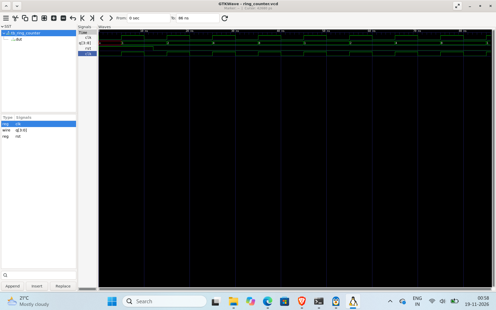
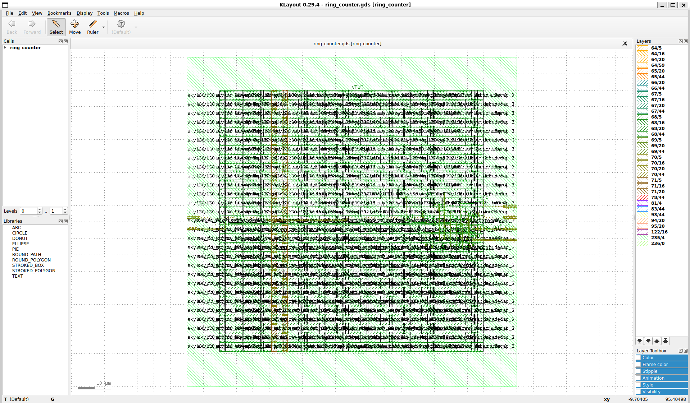

# 4-Bit Ring Counter — RTL to GDSII Using SKY130

A complete educational ASIC design project implementing a **4-bit synchronous ring counter**, from Verilog RTL design and functional simulation through physical implementation and GDSII generation using OpenLane and the SkyWater SKY130A PDK.

## Project Overview

A ring counter is a shift-register-based sequential circuit in which a logic `1` circulates through a series of flip-flops. This project implements a 4-bit ring counter with a synchronous, active-high reset.

### Functional Specifications

| Parameter | Description |
|---|---|
| Design | 4-bit Ring Counter |
| RTL language | Verilog HDL |
| Counter width | 4 bits |
| Clock | Positive-edge triggered |
| Reset | Synchronous, active-high |
| Reset state | `0001` |
| Technology | SkyWater SKY130A |
| Standard-cell library | `sky130_fd_sc_hd` |
| Physical design flow | OpenLane Classic |

### State Sequence

After reset is asserted, the counter initializes to `0001`. On each subsequent rising clock edge, the logic `1` shifts to the next position.

| Clock cycle | Output `q[3:0]` |
|---:|:---:|
| Reset | `0001` |
| 1 | `0010` |
| 2 | `0100` |
| 3 | `1000` |
| 4 | `0001` |

The sequence repeats continuously.

## RTL Implementation

The design is implemented in Verilog using a positive-edge-triggered sequential block and non-blocking assignments.

```verilog
module ring_counter (
    input  wire       clk,
    input  wire       rst,
    output reg  [3:0] q
);

    always @(posedge clk) begin
        if (rst)
            q <= 4'b0001;
        else
            q <= {q[2:0], q[3]};
    end

endmodule
```

## Simulation Results

Functional simulation was performed using Icarus Verilog, and the resulting waveform was inspected using GTKWave.



## Physical Design Layout

The design was implemented using OpenLane with the SKY130A PDK. The physical layout was generated and inspected using KLayout.



## ASIC Design Flow

The project follows this RTL-to-GDSII workflow:

1. RTL design using Verilog HDL.
2. Functional verification using Icarus Verilog.
3. Waveform inspection using GTKWave.
4. Synthesis using Yosys.
5. Floorplanning and power distribution network generation.
6. Placement and clock-tree synthesis.
7. Global routing and detailed routing.
8. Physical verification and GDSII generation.

## Implementation Results

The following values were collected from the OpenLane run metrics.

| Metric | Result |
|---|---:|
| Standard-cell instance area | 364.099 µm² |
| Die area | 10,000 µm² |
| Core area | 6,277.27 µm² |
| Estimated total power | 95.465 µW |
| Estimated internal power | 80.285 µW |
| Estimated switching power | 15.179 µW |
| Estimated leakage power | 0.000983 µW |
| Setup worst slack | 6.192 ns |
| Hold worst slack | 0.397 ns |
| Setup violations | 0 |
| Hold violations | 0 |

*Power values are tool-generated estimates, not measurements from fabricated silicon.*

## Physical Verification

The completed OpenLane run reported:

| Verification | Result |
|---|---|
| Design Rule Check (DRC) | Passed |
| Layout Versus Schematic (LVS) | Passed |
| Antenna Check | Passed |
| Setup timing violations | 0 |
| Hold timing violations | 0 |

Detailed verification reports are available in [`deliverables/verification/`](deliverables/verification/).

## Tools and Technologies

- Verilog HDL
- Icarus Verilog
- GTKWave
- Yosys
- OpenLane 2.3.10
- SkyWater SKY130A PDK
- `sky130_fd_sc_hd` standard-cell library
- KLayout

## Repository Structure

```text
ring_counter/
├── src/
│   └── ring_counter.v
├── tb/
│   └── tb_ring_counter.v
├── docs/
│   ├── images/
│   │   ├── simulation_waveform.png
│   │   └── klayout_full.png
│   └── PROJECT_REPORT.md
├── deliverables/
│   ├── ring_counter.gds
│   ├── ring_counter.def
│   ├── ring_counter.lef
│   ├── ring_counter.v
│   ├── tb_ring_counter.v
│   ├── config.json
│   ├── metrics.csv
│   ├── metrics.json
│   └── verification/
├── config.json
├── .gitignore
└── README.md
```

## Running the Functional Simulation

From the repository root, with Icarus Verilog installed:

```bash
iverilog -g2012 -o ring_counter_sim src/ring_counter.v tb/tb_ring_counter.v
vvp ring_counter_sim
```

The testbench output can be used to verify the expected repeating ring-counter sequence.

## Project Limitations

This is an educational ASIC implementation intended to demonstrate the RTL-to-GDSII flow. Although the reported DRC, LVS, and antenna checks passed, this result should not be considered tapeout-ready.

Further work would include reviewing complete timing constraints, power-integrity analysis, signoff methodology, and foundry-specific manufacturing requirements.

## Author

Designed and implemented as an educational ASIC design project to explore RTL development, functional verification, synthesis, physical design, and layout generation.
